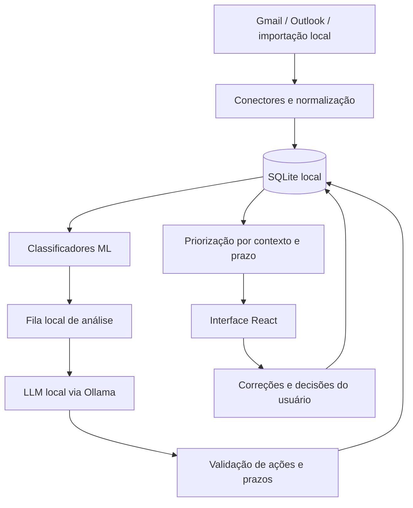

# Planejamento — assistente local de e-mail

Proposta inicial para discussão, elaborada em 25/09/2026 a partir de `enunciado.pdf`, `roteiro.md` e dos requisitos do usuário. Não representa funcionalidades já implementadas.

## 1. Conceito

Uma central pessoal de atenção que reúne várias contas de e-mail e ajuda a decidir o que fazer primeiro. Nome provisório: **Foco**.

O usuário conecta suas contas, consulta uma fila unificada, entende por que cada mensagem merece atenção e recebe resumos, sugestões de ações e rascunhos de resposta. Treinamento dos classificadores, inferência, armazenamento e geração de texto acontecem no computador.

A experiência principal responde: **“O que precisa da minha atenção hoje?”**

Exemplo ilustrativo: uma mensagem da faculdade informa que um trabalho vence amanhã; uma fatura do Gmail vence em dez dias; uma newsletter chega no Outlook. A interface destaca a entrega, mantém a fatura entre os próximos prazos e deixa a newsletter entre as mensagens informativas. Cada item preserva a identificação da conta e o vínculo com a mensagem original.

## 2. O que significa funcionar localmente

- Interface, API, banco, classificadores e LLM executados no computador.
- Acesso à internet para autenticar e sincronizar com os provedores e para baixar dependências e modelos na instalação.
- Depois da instalação, mensagens já sincronizadas podem ser consultadas e analisadas sem internet.
- Nenhum conteúdo de e-mail enviado a serviços externos de IA.
- Fontes, ícones e demais recursos da interface distribuídos com o aplicativo.
- Ollama configurado para uso exclusivamente local, sem modelos de nuvem.

Os e-mails continuam hospedados em seus provedores. “IA local” não significa transformar Gmail e Outlook em serviços offline.

## 3. Experiência de uso

### Configuração inicial

1. Verificar se o serviço de IA local e um modelo compatível estão disponíveis.
2. Conectar uma ou mais contas ou entrar no modo de demonstração com arquivos `.eml`.
3. Escolher o período inicial de sincronização; sugestão inicial: últimos 30 dias.
4. Acompanhar a importação e começar a consultar mensagens antes de terminar todo o processamento.

### Tela principal

Layout de três áreas no desktop:

- **Navegação:** Hoje, Todas as mensagens, Ações, contas e configurações.
- **Lista:** mensagens ou ações ordenadas por prioridade, com conta de origem, remetente, assunto, categoria e prazo quando identificado.
- **Detalhe:** mensagem, resumo, evidências do prazo, ação sugerida e rascunho editável.

A visão Hoje mostra o que precisa de ação, próximos prazos e itens que exigem revisão. Deve distinguir “nenhuma pendência encontrada” de “mensagens ainda não analisadas”.

Cada sugestão de ação admite confirmação, conclusão e adiamento local. Esses estados não alteram a mensagem no provedor na primeira versão. A conclusão é informada pelo usuário; o sistema não presume que uma obrigação foi cumprida.

### Direção visual

Interface sóbria, com boa tipografia, espaçamento consistente, listas compactas e cores usadas com significado. Tema claro e escuro, navegação por teclado, foco visível e indicadores que não dependam apenas de cor. Identificação permanente da conta evita confusão entre e-mail pessoal, profissional e acadêmico.

Estados de carregamento, ausência de mensagens, falha de autenticação e indisponibilidade do LLM fazem parte do desenho. Evitar ocupar a tela principal com métricas de treinamento; elas pertencem a uma área de avaliação.

## 4. Escopo da primeira entrega

### Compromissos centrais

- Várias contas conectadas, incluindo Gmail e Outlook, com filtros individuais e visão unificada.
- Sincronização incremental e importação de `.eml` para testes e demonstração offline.
- Classificação supervisionada local de categoria e prioridade inicial.
- Resumo, extração de ações e prazos e rascunho de resposta com LLM local.
- Priorização que considera prazo confirmado e estado da ação.
- Busca textual e filtros por conta, categoria e prioridade.
- Correção manual de classificação e registro de feedback.
- Interface completa e resultados de avaliação reproduzíveis.

### Evoluções após estabilizar a entrega

- Conector IMAP genérico para ampliar os provedores compatíveis.
- Busca semântica e perguntas sobre e-mails, com referências às mensagens recuperadas.
- Envio de respostas após revisão explícita e operações de organização no provedor.
- Análise de anexos e integração com calendário.
- Instalador desktop e personalização mais avançada dos modelos.

Na primeira entrega, os rascunhos são locais e podem ser copiados. Enviar, apagar e arquivar no provedor amplia autenticação, testes e consequências das ações; será uma etapa separada de produto.

## 5. Integração com contas

| Provedor | Caminho proposto | Observação |
|---|---|---|
| Gmail | Gmail API com OAuth e leitura | `gmail.readonly` é um escopo restrito; validar a configuração para o público de teste desde o início. |
| Outlook/Hotmail/Microsoft 365 | Microsoft Graph com OAuth e permissão delegada de leitura | `Mail.Read` admite contas pessoais e de trabalho/escola; políticas institucionais precisam ser verificadas na conta real. |
| Outros provedores | Adaptador IMAP | Compatibilidade depende da autenticação e dos recursos habilitados pelo provedor. |
| Dados locais | Importador `.eml` | Permite desenvolver e demonstrar o processamento independentemente das conexões. |

Fontes: [escopos do Gmail](https://developers.google.com/workspace/gmail/api/auth/scopes) e [permissões do Microsoft Graph](https://learn.microsoft.com/en-us/graph/permissions-reference#mailread).

Cada conta mantém credenciais, cursor de sincronização e estado de conexão independentes. Mensagens são identificadas por conta e identificador do provedor; títulos iguais não bastam para deduplicar. Uma conta com erro não deve interromper as demais.

OAuth exige cadastro do aplicativo nos provedores mesmo quando o programa roda localmente. A prova de conexão com uma conta real de cada serviço deve ocorrer no primeiro ciclo do projeto.

## 6. Arquitetura proposta

| Camada | Escolha inicial | Motivo |
|---|---|---|
| Interface | React, TypeScript, Vite e Tailwind CSS | Controle sobre composição, interação e acabamento visual. |
| Backend | Python e FastAPI | Integração direta com os classificadores e processamento de e-mails. |
| Persistência | SQLite | Banco local, sem um serviço adicional para instalar. |
| ML | scikit-learn | Treino e comparação de modelos supervisionados. |
| LLM | Ollama com modelo instalado localmente | Serviço local separado da interface e escolha de modelo conforme hardware. |
| Processamento | Worker local e fila persistida no SQLite | Retomada após interrupções e interface disponível durante tarefas demoradas. |

São escolhas propostas, a confirmar no primeiro protótipo. O frontend compilado pode ser servido pelo próprio backend em `127.0.0.1`; o navegador acessa o aplicativo local. Um iniciador deve simplificar a execução dos serviços. Empacotamento nativo pode ser feito depois.

O modelo de dados mínimo inclui contas, mensagens, conversas, classificações, análises, ações, rascunhos, feedback e tarefas pendentes. Todo resultado guarda a versão do modelo/prompt e a mensagem de origem.

## 7. ML com avaliação defensável

Manter dois problemas supervisionados: categoria e prioridade inicial. Categorias provisórias: faculdade, trabalho, financeiro, pessoal e promoções, com regras de desempate no guia de anotação. A categoria deve representar o propósito predominante da mensagem.

Começar com TF-IDF e Regressão Logística e comparar com Naive Bayes e SVM linear. Incluir uma referência simples, como classe majoritária, para mostrar o ganho real. Não escolher o vencedor antes dos experimentos.

Meta inicial: 300–500 mensagens rotuladas como estudo piloto, buscando exemplos suficientes em cada classe. Esse volume não garante generalização. Usar dados autorizados e desidentificados; substituição de nomes isoladamente não garante anonimização. Mensagens sintéticas podem complementar desenvolvimento, mas devem ser identificadas e não substituir o teste com mensagens representativas.

Escrever o guia de rotulagem antes de anotar em escala. Para prioridade, definir o instante de referência e distinguir solicitação de ação, prazo explícito e linguagem promocional. “URGENTE” no assunto não determina o rótulo sozinho. Dois integrantes anotam uma amostra comum e discutem divergências.

Separar treino, validação e teste mantendo mensagens da mesma conversa e duplicatas no mesmo grupo. Ajustar TF-IDF somente no treino. Se houver dados suficientes, acrescentar avaliação temporal. O conjunto final de teste fica fora das decisões de ajuste e do ciclo de feedback.

Medir macro-F1, precisão/recall por classe, matriz de confusão e tempo de processamento. Dar atenção especial ao recall de mensagens urgentes, reportando também o custo dos falsos alarmes. A documentação do [scikit-learn sobre validação](https://scikit-learn.org/stable/modules/cross_validation.html) descreve separações por grupos e por tempo.

Correções atualizam a preferência visível imediatamente e entram em uma base de feedback. Retreinar é uma operação controlada: comparar versões antes de substituir o classificador. Mostrar indícios da classificação, sem apresentar probabilidade não calibrada como certeza.

## 8. LLM e prioridade dinâmica

O LLM recebe o texto e o contexto necessário da conversa e produz uma estrutura validada: resumo, ações, prazo ou ausência de prazo, trecho de evidência e rascunho quando solicitado. Saídas estruturadas são suportadas pelo [Ollama](https://docs.ollama.com/capabilities/structured-outputs); formato válido não garante conteúdo correto.

Prazos relativos, como “amanhã”, devem considerar a data e o fuso da mensagem. Datas ambíguas exigem revisão; nenhuma data deve ser inventada para completar campos. Preservar o original permite conferir o que foi removido durante a limpeza e resolver conflitos entre mensagens antigas e recentes.

O classificador estima prioridade inicial; a ordenação atual considera também prazo validado, ação pendente e ajustes do usuário. Uma fatura com vencimento distante pode subir de prioridade sem receber um novo e-mail.

Para controlar o custo computacional:

- Classificar todas as mensagens com ML.
- Priorizar no LLM mensagens abertas, prováveis ações e possíveis prazos.
- Oferecer análise manual de qualquer mensagem e fila de cobertura em segundo plano dentro do orçamento configurado.
- Gerar rascunhos sob demanda e reutilizar análises por conteúdo e versão.
- Exibir o que está pendente de análise; baixa prioridade prevista não equivale a ausência confirmada de prazo.

Escolher o modelo local com um pequeno comparativo na máquina de destino: fidelidade em português, extração de datas, tempo de resposta e memória. Tamanho e quantização permanecem em aberto até conhecer o hardware.

## 9. Privacidade, segurança e limites

Guardar tokens no cofre de credenciais do sistema operacional. Servir API e Ollama apenas em loopback, restringir origens e proteger operações locais contra chamadas indevidas de outras páginas. Conteúdo de e-mail e segredos não entram em logs comuns nem no repositório.

Sanitizar HTML e bloquear carregamento automático de imagens remotas. Tratar instruções dentro dos e-mails como conteúdo não confiável; o LLM não recebe ferramentas para executar comandos ou operar contas. Rascunhos não devem assumir compromissos ou afirmar pagamentos/entregas sem evidência.

Oferecer remoção de contas e de seus dados locais, documentar retenção e explicar a proteção do banco em repouso. SQLite sozinho não implica criptografia. Execução local reduz exposição, mas não é, por si só, prova de conformidade legal.

Configurar o modo exclusivamente local do Ollama e verificar a análise com a rede desconectada. Referência: [FAQ do Ollama](https://docs.ollama.com/faq), incluindo `OLLAMA_NO_CLOUD=1`.

## 10. Sequência de execução

| Etapa | Resultado concreto |
|---|---|
| 1. Viabilidade | Conexão real Gmail + Outlook, teste do LLM no hardware e protótipo visual navegável. |
| 2. Fluxo completo mínimo | Importar/sincronizar → persistir → classificar → listar → abrir mensagem. |
| 3. Inteligência | Treino comparativo, LLM estruturado, ações, prazos e rascunhos. |
| 4. Produto | Múltiplas contas, sincronização incremental, feedback, busca e acabamento dos estados da interface. |
| 5. Validação e defesa | Avaliação congelada, testes de integração, ensaio offline e material de apresentação. |

Rotulagem e guia de anotação começam na etapa 1 e seguem durante a construção do sistema. Se o prazo de 26/10 se confirmar, reservar os últimos dias para estabilização e ensaio, ajustando as etapas às horas disponíveis do grupo.

O roteiro menciona 26/10. O enunciado traz 26/10 para P2.2 e 04/11 para P2.1. Confirmar a turma antes de fechar as datas.

## 11. Critérios de conclusão

- Demonstrar ao menos duas contas simultâneas, uma Gmail e uma Outlook, com conta de origem sempre visível.
- Repetir sincronização sem duplicar mensagens e isolar falhas entre contas.
- Reiniciar o aplicativo preservando mensagens, ações, correções e tarefas pendentes.
- Analisar mensagens já baixadas e gerar um novo resultado de LLM com a rede desligada.
- Exibir evidência dos prazos extraídos e tratar explicitamente datas ambíguas ou ausentes.
- Continuar permitindo consulta e classificação quando o LLM estiver indisponível.
- Reportar ML em teste separado e comparar com referências simples.
- Avaliar o LLM com exemplos de prazo, ausência de prazo, respostas citadas e conteúdo adversarial, medindo fidelidade e erros.
- Medir latência e uso de memória no hardware real e registrar as condições dos experimentos.
- Demonstrar o ciclo completo com dados preparados para apresentação sem expor correspondência pessoal.

Isso produz evidências para os quatro itens obrigatórios do enunciado: ML (10%), LLM (10%), sistema completo (25%) e reflexão ética (5%).

## 12. Decisões ainda abertas

- Hardware da máquina de desenvolvimento e da demonstração.
- Turma, prazo efetivo e disponibilidade semanal dos integrantes.
- Tipos de conta a conectar: pessoais, institucionais ou ambos.
- Volume de mensagens autorizadas disponível para rotulagem.
- Preferência final de identidade visual e necessidade de instalador na entrega.
